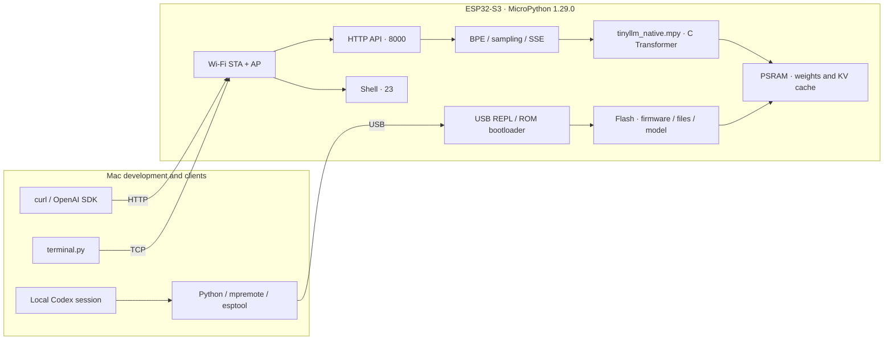

# ESP32 LLM Service

**English** | [简体中文](README.zh-CN.md)

Run a language model locally on an ESP32-S3, expose an OpenAI Chat Completions compatible API over Wi-Fi, and keep a login-based MicroPython shell available.

**Inference, weights, tokenization, and the KV cache all run on the ESP32.** The Mac builds and deploys the project over USB and sends HTTP requests. Once installed, the board only needs power to serve requests.

The included, hardware-verified backend is **TinyStories 260K FP32**. ESP32-S3 can also run larger models with suitable quantization, memory placement, and inference kernels. See [model choices and constraints](docs/models.md) for six candidates, their repositories, and integration requirements. This release loads only the pinned 260K checkpoint.

> The included model has 260,032 parameters and continues simple English stories. It has no chat instruction training, general Chinese question answering, or tool calling. “OpenAI compatible” describes the documented HTTP request and response formats.

[Documentation index](docs/README.md) · [Hardware and shopping](docs/hardware.md) · [Setup](docs/setup.md) · [Installation and recovery](docs/installation.md) · [Codex workflow](docs/codex.md) · [Architecture](docs/architecture.md) · [Model selection](docs/models.md) · [API](docs/api.md) · [Operations](docs/operations.md) · [Validation](docs/validation.md)

## Features

- TinyStories 260K FP32 Transformer in native C; BPE tokenization and sampling in MicroPython.
- `GET /health`, `GET /v1/models`, `POST /v1/chat/completions`, and `POST /v1/completions`.
- JSON and SSE streaming responses, Bearer authentication, usage accounting, stop strings, and reproducible sampling.
- A 2.4 GHz Wi-Fi station connection plus a WPA2 access point at `192.168.4.1`.
- TCP shell with login, file operations, system information, MicroPython execution, Ctrl-C, and reboot.
- Pinned downloads, SHA-256 checks, configuration generation, native builds, incremental deployment, and verification scripts.

## Architecture



The HTTP service processes requests sequentially in a background thread. The shell runs on the main thread so user Python can be interrupted. Both remain available during inference. See [architecture](docs/architecture.md) for startup order and memory ownership.

## Hardware and verified versions

| Component | Verified configuration |
| --- | --- |
| MCU | ESP32-S3 rev 0.2, 240 MHz |
| Storage | 16 MB Flash, 8 MB **Octal PSRAM** |
| Development host | macOS / Apple Silicon, USB data cable |
| Firmware | MicroPython 1.29.0, `ESP32_GENERIC_S3-SPIRAM_OCT` |
| Python | 3.11; dependencies pinned in `requirements.txt` |
| Build tools | Arduino CLI 1.5.1, ESP32 core 3.3.8, Xtensa GCC 14.2 / `esp-x32/2601` |
| Native module | `.mpy`, `ARCH=xtensawin`, `LINK_RUNTIME=1` |
| Client | Official OpenAI Python SDK 3.35.1 |

Other ESP32 chips, boards without PSRAM, Quad PSRAM firmware, and different MicroPython ABIs have not been verified by this project. Identify the actual hardware before choosing firmware.

## Hardware shopping list

Start with **one N16R8 board, one USB data cable, your existing Mac, and an existing 2.4 GHz Wi-Fi network**. No soldering or additional electronics are needed for the current service.

| Item | Quantity | Model / specification | Purchase or reuse |
| --- | --- | --- | --- |
| Development board | 1 | Reference choice: **Waveshare ESP32-S3-DEV-KIT-N16R8**, SKU **28409**; **N16R8-M**, SKU **28836**, adds soldered headers. Module: **ESP32-S3-WROOM-1-N16R8**, 16 MB Flash / 8 MB Octal PSRAM, onboard antenna. | [International store](https://www.waveshare.com/product/mcu-tools/esp32-s3-dev-kit-n8r8.htm), select **1-N16R8**; [China store](https://dd.waveshare.net/shop/ESP32-S3-DEV-KIT-N16R8.htm); [manufacturer specifications](https://docs.waveshare.net/ESP32-S3-DEV-KIT-N8R8/) |
| USB data cable | 1 | USB 2.0 data support; USB-C to USB-C for the example board and a USB-C Mac. Match connectors on other boards. | Reuse a working data cable. A documented example is [Apple 60W USB-C Charge Cable, 1 m](https://www.apple.com/shop/product/MW493AM/A/60w-usb-c-charge-cable-1-m); this project does not require 60W. |
| Development computer | 1 existing | Apple Silicon Mac, Internet access for downloads, USB port | Reuse your Mac; no GPU is needed for on-board inference. |
| Wi-Fi network | 1 existing for LAN mode | 2.4 GHz WPA2, device-to-device access enabled | Reuse your router. After installation, the ESP32 AP also provides direct access. |
| USB power adapter | Optional, 1 | Regulated 5 V USB supply; 1 A or greater is a practical bare-board choice, subject to the board specification | Reuse a suitable phone supply for standalone use. Mac USB powers development. |
| Data adapter / hub | Optional | Only if cable and Mac connectors differ | Reuse a data-capable USB adapter; start with a direct cable where possible. |

Choose a complete development board with USB and BOOT/RESET buttons. For the referenced WROOM-1 module, **N16R8** means 16 MB Flash plus 8 MB Octal PSRAM; **N16** alone has no PSRAM, and **N8R8** has only 8 MB Flash. Flash and PSRAM have different interfaces, so do not confuse Octal PSRAM with Octal Flash. See the [Espressif module table](https://www.espressif.com/sites/default/files/documentation/esp32-s3-wroom-1_wroom-1u_datasheet_en.pdf).

For shopping variants, native USB versus USB-UART, cable checks, and a checklist of expected results, follow the [hardware and first-connection guide](docs/hardware.md). The Waveshare example has one USB-C socket that can expose two serial devices; the guide explains which one to use.

## Model choices and hardware limits

Model capacity is constrained by **weight storage, available RAM, KV cache, memory bandwidth, and runtime compatibility**, not a universal parameter limit. The current 16 MB Flash / 8 MB PSRAM board has to fit firmware, networking, the shell, tokenizer, and inference buffers too. INT4 weights need at least `parameters / 2` bytes before scales and metadata; storing weights in Flash can save RAM but requires a suitable engine and partition layout.

| Candidate | Format / approach | Status for this project | Model and runtime sources |
| --- | --- | --- | --- |
| TinyStories 260K | FP32, weights in RAM | Included and hardware-verified | [Weights](https://huggingface.co/karpathy/tinyllamas/tree/main/stories260K) · [Upstream C engine](https://github.com/doryiii/esp32-llm) |
| TinyStories 3.3M | INT8 | Upstream ESP32-S3 result; needs an INT8 backend | [Weights and engine](https://github.com/doryiii/esp32-llm) |
| Barista 8.9M | INT4 PLE, restricted espresso question answering | Upstream ESP32-S3 result; needs its own runtime and vocabulary mappings | [Weights](https://huggingface.co/slvDev/esp32-ai-barista) · [Engine](https://github.com/slvDev/esp32-ai) |
| Stories15M / 15.2M | INT4, weights mapped from Flash | Upstream ESP32-S3 result; needs a port or replacement firmware | [Base weights](https://huggingface.co/karpathy/tinyllamas) · [NanoMind-S3](https://github.com/imFARSI/NanoMind-S3) |
| esp32-ai TinyStories 28.9M | INT4 PLE, large lookup tables in Flash | Upstream ESP32-S3 result; needs a custom runtime and partition plan | [Weights](https://huggingface.co/slvDev/esp32-ai-tinystories) · [Engine](https://github.com/slvDev/esp32-ai) |
| record42 / 30.72M | Vocabulary-trimmed Stories42M, INT4 | Upstream ESP32-S3 result; very tight Flash budget and replacement firmware | [Base weights](https://huggingface.co/karpathy/tinyllamas) · [esp32-30.7M](https://github.com/JARACH-209/esp32-30.7M) |

Only the first row has been tested in this repository. The other rows are research candidates, not selectable API models. PLE parameter counts include large lookup tables and are not equivalent to the same number of dense Transformer parameters. Larger story models do not automatically gain chat or Chinese capabilities. The [bilingual model guide](docs/models.md) provides exact artifact sizes, RAM formulas, upstream benchmarks, pinned source revisions, and a migration checklist.

## Install from scratch

Open **Terminal** on the Mac (Spotlight → Terminal). Run command blocks in order; after cloning, keep the terminal in `esp32-llm-service`. Replace example ports, IP addresses, SSIDs, and keys with your own values. Commands use `.venv/bin/...` directly, so virtual-environment activation is unnecessary.

For an already installed board, use the deployment script in step 6 to update code. Flash erasure is part of the initial firmware installation only.

### 1. Development tools and Python environment

After installing [Homebrew](https://brew.sh/):

```sh
xcode-select --install
brew install python@3.11 arduino-cli git

git clone https://github.com/InfronAI/esp32-llm-service.git
cd esp32-llm-service
python3.11 -m venv .venv
.venv/bin/python -m pip install -r requirements.txt

arduino-cli core update-index --additional-urls https://espressif.github.io/arduino-esp32/package_esp32_index.json
arduino-cli core install esp32:esp32@3.3.8 --additional-urls https://espressif.github.io/arduino-esp32/package_esp32_index.json
```

Skip the first command if Xcode Command Line Tools are already installed. The Arduino core supplies the Xtensa cross compiler; the board runs MicroPython. See [setup](docs/setup.md) for paths, proxies, and dependency roles.

### 2. Connect Codex to the local project and USB tools

Follow the [OpenAI Docs Codex CLI installation guide](https://learn.chatgpt.com/docs/codex/cli), then sign in:

```sh
curl -fsSL https://chatgpt.com/codex/install.sh | sh
codex login
codex -C "$PWD"
```

A local Codex session on the Mac reads the repository and invokes `.venv/bin/python`, `mpremote`, `esptool`, and the build scripts to access USB. [AGENTS.md](AGENTS.md) records hardware constraints and verification procedures. For example:

> Read README and AGENTS.md. Detect the ESP32 USB port and confirm the chip, Flash, and PSRAM configuration. Describe the current firmware state, then prepare dependencies and deploy using the installation guide. Use the existing private local configuration. Verify health, an OpenAI SDK request, and restart recovery.

Codex login and the ESP32 API key are separate credentials. The 260K model is an on-device continuation experiment and lacks the Responses API and tool calling needed to act as a Codex backend. See the [Codex development workflow](docs/codex.md).

### 3. Download pinned assets and build the C module

```sh
.venv/bin/python scripts/prepare.py
.venv/bin/python scripts/build_native.py
```

`prepare.py` downloads firmware, approximately 1 MB of model weights, the tokenizer, and pinned MicroPython sources, checking SHA-256 hashes and the Git commit. The build produces `native/tinyllm_native.mpy`. Versions are recorded in [BUILD.md](BUILD.md), the [model manifest](models/manifest.json), and the [firmware manifest](firmware/manifest.json).

### 4. Find the port, back up, and install MicroPython

```sh
.venv/bin/python -m serial.tools.list_ports -v
export ESP32_PORT=/dev/cu.usbmodemXXXX   # Replace with the detected port
.venv/bin/python -m esptool --chip esp32s3 --port "$ESP32_PORT" flash-id
```

After confirming the target board and its 16 MB Flash, perform the initial installation. **Erasing deletes existing firmware and files; keep a backup first.**

```sh
mkdir -p backups
.venv/bin/python -m esptool --chip esp32s3 --port "$ESP32_PORT" --baud 921600 --after watchdog-reset read-flash 0 0x1000000 backups/original.bin
shasum -a 256 backups/original.bin > backups/original.bin.sha256

.venv/bin/python -m esptool --chip esp32s3 --port "$ESP32_PORT" --after no-reset erase-flash
.venv/bin/python -m esptool --chip esp32s3 --port "$ESP32_PORT" --baud 921600 --after watchdog-reset write-flash 0 firmware/ESP32_GENERIC_S3-SPIRAM_OCT-20260824-v1.29.0.bin
```

The USB port may change after flashing; list ports again and update `ESP32_PORT`. If connection fails, hold BOOT, press and release RESET, then release BOOT. `watchdog-reset` reliably exited download mode on the verified board. See [installation](docs/installation.md) for recovery and the older firmware's optional USB 1200-baud touch method.

### 5. Generate device configuration

```sh
.venv/bin/python scripts/configure.py --ssid 'YOUR_2.4G_WIFI'
```

Enter the Wi-Fi password at the hidden prompt. The script generates random AP and shell passwords and an API key, then writes two files readable only by the local user:

| File | Purpose |
| --- | --- |
| `device/settings.json` | Wi-Fi, shell, and HTTP settings deployed to the ESP32 |
| `reports/access.json` | Addresses and credentials used by Mac clients |

Both are ignored by Git. Running the generator again refuses to overwrite existing credentials. New installations default to AP name `ESP32-LLM`, shell user `esp32`, and client address `192.168.4.1`. See [configuration fields](docs/installation.md#configuration-fields).

To view the generated credentials locally on macOS:

```sh
open -e reports/access.json
```

In that file, `ssid` / `wifi_password` are for joining the ESP32 AP, `user` / `password` are for shell login, and `api_key` is for HTTP requests. `sta_ssid` identifies the router network. Keep this file local.

### 6. Deploy and connect

```sh
.venv/bin/python scripts/deploy.py --port "$ESP32_PORT" --models --settings
```

The script checks local files, transfers code and models over USB, verifies each file's SHA-256, skips unchanged content, sets the RTC, and restarts the board. No further Flash erasure is needed. Startup usually takes a few seconds; Wi-Fi initialization can wait about 20 seconds if the router is unavailable.

Choose either connection:

- **LAN:** Connect the Mac and ESP32 to a mutually reachable network. Find the board IP in the router's DHCP list, USB startup log, or shell `ifconfig` output.
- **Direct AP:** Connect the Mac to the configured AP using the password in `reports/access.json`, then use `192.168.4.1`. The AP does not forward Internet traffic.

Save the discovered LAN IP in the local client configuration. This preserves credentials and does not modify the board:

```sh
.venv/bin/python scripts/configure.py --host-only 192.168.1.50   # Replace with the actual IP
.venv/bin/python scripts/chat.py 'Once upon a time' --tokens 64
./connect.command 192.168.1.50
```

Without `--port`, deployment auto-selects a USB device only when exactly one Espressif device is present. DHCP lease changes can change the LAN address.

### 7. Check the installation

```sh
.venv/bin/python scripts/check_llm.py
```

Run this after saving the reachable board IP in step 6. It exercises the API over the network using local credentials. Success should include an English continuation, working JSON/SSE calls, and shell access. The [checkpoint table](docs/hardware.md#installation-checkpoints) lists expected results for every installation stage. To run independently, move the USB cable to a suitable power adapter, allow startup, and verify the board at its current LAN IP or direct AP address.

## Call the API

Replace the IP and key below with values from your local `reports/access.json`. The placeholder key cannot authenticate.

```sh
export ESP32_IP=192.168.1.50
export ESP32_API_KEY='REPLACE_WITH_YOUR_LOCAL_KEY'

curl --noproxy '*' "http://$ESP32_IP:8000/health"

curl --noproxy '*' "http://$ESP32_IP:8000/v1/chat/completions" \
  -H 'Content-Type: application/json' \
  -H "Authorization: Bearer $ESP32_API_KEY" \
  -d '{
    "model": "tinystories-260k",
    "messages": [{"role": "user", "content": "Once upon a time"}],
    "max_tokens": 32,
    "temperature": 0
  }'
```

Example continuation:

```text
, there was a little girl named Lily. She loved to play outside in the park. One day, she saw
```

For streaming, add `"stream": true` to the request and `-N` to curl. See [API documentation](docs/api.md) for SSE, SDK calls, errors, and parameter bounds. Bypass host proxies for the ESP32 LAN address; the supplied Python client disables environment proxies.

## Service limits and measurements

The context is **512 tokens total**, with **1–256 output tokens** per request. HTTP requests run sequentially with a short queue. Chat message text is joined with two newlines; roles have no chat-model semantics. Multimodal inputs, tools, embeddings, the Responses API, nonzero penalties, and logprobs are not implemented.

| Measurement | Result on 2026-10-21 |
| --- | --- |
| 5-token prompt, 32-token output | 1.071 seconds on the board, about 29.88 tokens/s |
| First token | 116 ms, measured on the board |
| Full Mac HTTP round trip | About 1.70 seconds |
| 128-token output | About 25.67 tokens/s |
| OpenAI SDK / LAN checks | 34 passed |
| Original shell checks | 30 passed |
| Independent C reference comparison | All 32 tokens matched; maximum absolute logit error about `8.45e-6` |
| Restart recovery | Wi-Fi, model loading, and HTTP startup verified |

These are completed hardware measurements; context length and networking affect speed. [Validation](docs/validation.md) describes the methods and sanitized data. A [host CI template](ci/host-checks.yml) is provided but is not enabled automatically. It covers host checks, not physical hardware.

## Repository layout and maintenance

```text
device/                 MicroPython networking, shell, HTTP, and model logic
native/                 C Transformer, dynamic module entry points, and Makefile
scripts/                Download, configuration, build, deployment, clients, and checks
tests/                  Independent C reference, fixtures, host and device tests
models/manifest.json    Model sources, revision, sizes, and SHA-256 hashes
firmware/manifest.json  Firmware URL, version, source commit, and SHA-256
docs/                   Bilingual setup, installation, architecture, models, API, and operations
ci/                     Host CI template and activation instructions
```

For routine updates, run `.venv/bin/python scripts/deploy.py`; board configuration and user files are preserved. Add `--settings` after changing configuration and `--models` for initial installation or weight repair. After shell `passwd`, synchronize the board configuration before deploying settings again. USB REPL maintenance interrupts services; restart afterward. See [operations](docs/operations.md) for backups and troubleshooting.

## Sources and licensing

The C inference core is adapted from [doryiii/esp32-llm](https://github.com/doryiii/esp32-llm/tree/c6c647f7bfbb74efd2bbfd9a1725da4a903589f4) and [karpathy/llama2.c](https://github.com/karpathy/llama2.c). Manifests record source revisions and asset hashes. This project uses the [MIT License](LICENSE); upstream files retain their notices. Model weights and toolchains retain their upstream terms. See [third-party notices](THIRD_PARTY_NOTICES.md).
