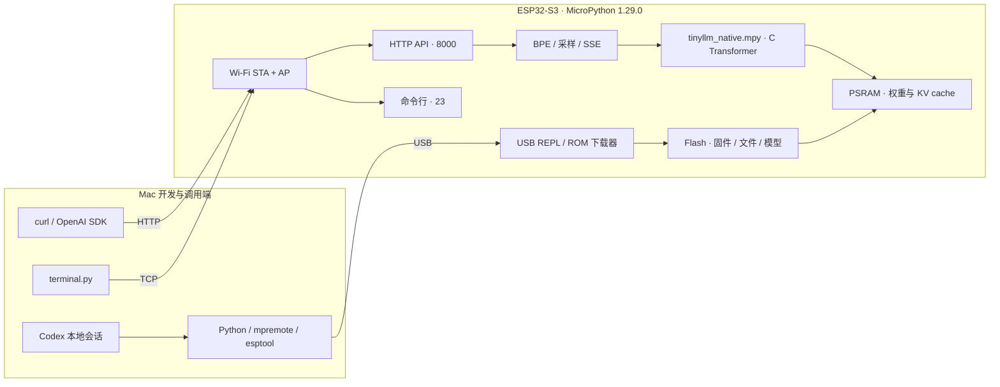

# ESP32 LLM Service

[English](README.md) | **简体中文**

在 ESP32-S3 上运行本地语言模型，通过 Wi-Fi 提供 OpenAI Chat Completions 兼容接口，并保留可登录的 MicroPython 命令行。

**推理、权重、分词器和 KV cache 均在 ESP32 上。** Mac 负责开发、USB 部署和发送 HTTP 请求；开发结束后，板子只需供电即可提供服务。

本项目内置并实机验证的后端是 **TinyStories 260K FP32**。ESP32-S3 还可以通过合适的量化、内存布局和推理内核运行更大的模型。[模型选型与约束文档](docs/models.zh-CN.md)列出六个候选、来源仓库及移植要求；当前版本只加载固定的 260K 权重。

> 内置模型有 260,032 个参数，适合英文故事续写，未经聊天指令训练。它不具备通用中文问答、工具调用或 ChatGPT 的能力。“OpenAI 兼容”指本文列出的 HTTP 请求与响应格式。

[文档索引](docs/README.zh-CN.md) · [硬件采购](docs/hardware.zh-CN.md) · [环境准备](docs/setup.zh-CN.md) · [安装与恢复](docs/installation.zh-CN.md) · [Codex 开发](docs/codex.zh-CN.md) · [系统架构](docs/architecture.zh-CN.md) · [模型选择](docs/models.zh-CN.md) · [API](docs/api.zh-CN.md) · [维护排障](docs/operations.zh-CN.md) · [验证记录](docs/validation.zh-CN.md)

## 已实现

- TinyStories 260K FP32 原生 C Transformer；MicroPython 实现 BPE 分词和采样。
- `GET /health`、`GET /v1/models`、`POST /v1/chat/completions`、`POST /v1/completions`。
- 普通 JSON 和 SSE 流式响应、Bearer 鉴权、usage、停止词和可复现采样。
- 连接 2.4 GHz Wi-Fi，同时保留 WPA2 热点入口 `192.168.4.1`。
- TCP shell：登录、文件读写、系统信息、MicroPython 执行、Ctrl-C 和重启。
- 固定版本下载、SHA-256 校验、配置生成、原生模块构建、增量部署和验证脚本。

## 系统架构



HTTP 服务在后台线程中串行处理请求；shell 在主线程运行，以支持中断用户 Python。推理与 shell 可同时使用。详细启动时序和内存布局见[架构文档](docs/architecture.zh-CN.md)。

## 硬件与已验证版本

| 项目 | 已验证配置 |
| --- | --- |
| MCU | ESP32-S3 rev 0.2，240 MHz |
| 存储 | 16 MB Flash，8 MB **Octal PSRAM** |
| 开发主机 | macOS / Apple Silicon，USB 数据线 |
| 固件 | MicroPython 1.29.0，`ESP32_GENERIC_S3-SPIRAM_OCT` |
| Python | 3.11，依赖固定在 `requirements.txt` |
| 构建工具 | Arduino CLI 1.5.1，ESP32 core 3.3.8，Xtensa GCC 14.2 / `esp-x32/2601` |
| 原生模块 | `.mpy`，`ARCH=xtensawin`，`LINK_RUNTIME=1` |
| 客户端 | 官方 OpenAI Python SDK 3.35.1 |

其他 ESP32 芯片、无 PSRAM 板卡、Quad PSRAM 固件和不同 MicroPython ABI 不在本项目的已验证范围内。首先确认实际硬件，不能仅依据商品名称选择固件。

## 硬件采购清单

从 **1 块 N16R8 开发板、1 根 USB 数据线、现有 Mac 和现有 2.4 GHz Wi-Fi** 开始即可。当前服务无需焊接或增加其他电子器件。

| 物品 | 数量 | 型号 / 规格 | 购买或复用方式 |
| --- | --- | --- | --- |
| 开发板 | 1 块 | 参考选择：**微雪 ESP32-S3-DEV-KIT-N16R8**，SKU **28409**；已焊排针版为 **N16R8-M**，SKU **28836**。模组 **ESP32-S3-WROOM-1-N16R8**，16 MB Flash / 8 MB Octal PSRAM，板载天线。 | [国际商城](https://www.waveshare.com/product/mcu-tools/esp32-s3-dev-kit-n8r8.htm)，选择 **1-N16R8**；[中文商城](https://dd.waveshare.net/shop/ESP32-S3-DEV-KIT-N16R8.htm)；[厂商规格](https://docs.waveshare.net/ESP32-S3-DEV-KIT-N8R8/) |
| USB 数据线 | 1 根 | 支持 USB 2.0 数据；上述开发板和 USB-C Mac 可选 C-to-C，其他板按实际接口选线。 | 复用已知能传数据的线。规格示例为 [Apple 60W USB-C 充电线 1 米](https://www.apple.com/shop/product/MW493AM/A/60w-usb-c-charge-cable-1-m)，本项目不要求 60W。 |
| 开发电脑 | 现有 1 台 | Apple Silicon Mac、可下载依赖的网络、USB 接口 | 复用现有 Mac，板上推理不需要 GPU。 |
| Wi-Fi 网络 | LAN 模式使用现有 1 个 | 2.4 GHz WPA2，允许设备互访 | 复用路由器；安装后也能直连 ESP32 热点。 |
| USB 电源 | 可选 1 个 | 稳定 5 V USB 供电，裸板可选额定 1 A 或更高，遵循板厂规格 | 独立运行时复用合适的手机电源；开发期间 Mac USB 供电即可。 |
| 数据转接头 / Hub | 可选 | 仅在线材与 Mac 接口不匹配时需要 | 复用能传数据的 USB 转接头，首次连接优先直接接线。 |

原设备的芯片及内存已验证，品牌和 PCB 型号未记录；以上零售例子是**规格匹配项，并非逐一实测的板卡**。产品资料于 2026-10-21 核对，下单前确认已选 SKU、实时价格及库存。

购买带 USB、BOOT/RESET 按钮的完整开发板。对上述 WROOM-1 模组，**N16R8** 表示 16 MB Flash 加 8 MB Octal PSRAM；**N16** 没有 PSRAM，**N8R8** 只有 8 MB Flash。Flash 与 PSRAM 接口不同，不能把 Octal PSRAM 当成 Octal Flash，参见[乐鑫模组规格表](https://www.espressif.com/sites/default/files/documentation/esp32-s3-wroom-1_wroom-1u_datasheet_en.pdf)。

商品选项、原生 USB 与 USB-UART 区别、数据线排查和逐步成功标志，见[硬件采购与首次连接教程](docs/hardware.zh-CN.md)。上述微雪板一个 USB-C 接口可能出现两个串口，教程说明如何选择。

## 模型选择与硬件限制

模型容量受**权重存储、可用 RAM、KV cache、带宽和运行时兼容性**共同限制，没有统一的参数上限。当前 16 MB Flash / 8 MB PSRAM 还要容纳固件、网络、shell、分词器和推理缓冲区。INT4 裸权重至少需要 `参数量 / 2` 字节，另加缩放因子和元数据；Flash 存权重可节省 RAM，但需要对应内核和分区布局。

| 候选 | 格式 / 实现方式 | 本项目支持状态 | 模型与推理仓库 |
| --- | --- | --- | --- |
| TinyStories 260K | FP32，权重装入 RAM | 已内置并实机验证 | [权重](https://huggingface.co/karpathy/tinyllamas/tree/main/stories260K) · [上游 C 内核](https://github.com/doryiii/esp32-llm) |
| TinyStories 3.3M | INT8 | 上游有 ESP32-S3 结果；需移植 INT8 后端 | [权重与内核](https://github.com/doryiii/esp32-llm) |
| Barista 8.9M | INT4 PLE，受限咖啡领域问答 | 上游有 ESP32-S3 结果；需专用运行时及词表映射 | [权重](https://huggingface.co/slvDev/esp32-ai-barista) · [内核](https://github.com/slvDev/esp32-ai) |
| Stories15M / 15.2M | INT4，Flash 映射权重 | 上游有 ESP32-S3 结果；需移植或更换固件 | [原始权重](https://huggingface.co/karpathy/tinyllamas) · [NanoMind-S3](https://github.com/imFARSI/NanoMind-S3) |
| esp32-ai TinyStories 28.9M | INT4 PLE，大型查表放在 Flash | 上游有 ESP32-S3 结果；需专用运行时与分区规划 | [权重](https://huggingface.co/slvDev/esp32-ai-tinystories) · [内核](https://github.com/slvDev/esp32-ai) |
| record42 / 30.72M | 裁剪词表的 Stories42M，INT4 | 上游有 ESP32-S3 结果；Flash 预算紧张，需更换固件 | [原始权重](https://huggingface.co/karpathy/tinyllamas) · [esp32-30.7M](https://github.com/JARACH-209/esp32-30.7M) |

只有第一行在本仓库中经过测试；其余为研究候选，不能直接作为 API 模型选择。PLE 的参数包含大型查表，不等同于相同参数量的稠密 Transformer。更大的故事模型也不会自动获得聊天或中文能力。[双语模型指南](docs/models.zh-CN.md)提供精确文件大小、内存公式、上游性能、固定来源版本和移植流程。

## 从零安装

在 Mac 上打开**终端 Terminal**（Spotlight 搜索 Terminal）。按顺序执行代码块，克隆后保持位于 `esp32-llm-service` 目录。端口、IP、SSID 和 Key 的示例值需替换为自己的。命令直接使用 `.venv/bin/...`，不需要另行激活虚拟环境。

已经装好的板子更新代码时，直接使用第 6 步的部署脚本；首次刷写固件才会擦除 Flash。

### 1. 开发平台与 Python 环境

安装 [Homebrew](https://brew.sh/) 后：

```sh
xcode-select --install
brew install python@3.11 arduino-cli git

git clone https://github.com/InfronAI/esp32-llm-service.git
cd esp32-llm-service
python3.11 -m venv .venv
.venv/bin/python -m pip install -r requirements.txt

arduino-cli core update-index --additional-urls https://espressif.github.io/arduino-esp32/package_esp32_index.json
arduino-cli core install esp32:esp32@3.3.8 --additional-urls https://espressif.github.io/arduino-esp32/package_esp32_index.json
```

Xcode 命令行工具已安装时，可跳过第一条。Arduino core 在这里提供 Xtensa 交叉编译器；板子运行的是 MicroPython。安装路径、代理和依赖用途见[环境准备](docs/setup.zh-CN.md)。

### 2. 让 Codex 使用本地项目和 USB 工具

按照 [OpenAI Docs 的 Codex CLI 安装说明](https://learn.chatgpt.com/docs/codex/cli)安装并登录：

```sh
curl -fsSL https://chatgpt.com/codex/install.sh | sh
codex login
codex -C "$PWD"
```

Codex 在 Mac 的本地会话中读取仓库，调用 `.venv/bin/python`、`mpremote`、`esptool` 和构建脚本访问 USB。仓库内的 [AGENTS.md](AGENTS.zh-CN.md)说明硬件约束和验证方法。例如可以输入：

> 请阅读 README 和 AGENTS.md，检测本机 ESP32 USB 端口，核对芯片与 Flash/PSRAM 配置。先说明当前固件状态，再按安装文档准备依赖和部署。使用本机私有配置，完成后验证 health、OpenAI SDK 调用和重启恢复。

Codex 登录账号与 ESP32 的本地 API Key 分别管理。本项目的 260K 模型用于端侧续写实验；它没有驱动 Codex 所需的 Responses 和工具调用能力。详见 [Codex 连接与开发流程](docs/codex.zh-CN.md)。

### 3. 下载固定版本资源、构建 C 模块

```sh
.venv/bin/python scripts/prepare.py
.venv/bin/python scripts/build_native.py
```

`prepare.py` 下载固件、约 1 MB 模型权重、分词器及固定版本 MicroPython 源码，验证 SHA-256 / Git commit。构建输出为 `native/tinyllm_native.mpy`。源码、模型及固件版本分别记录于 [BUILD.md](BUILD.zh-CN.md)、[模型清单](models/manifest.json)和[固件清单](firmware/manifest.json)。

### 4. 检测端口，备份并安装 MicroPython

```sh
.venv/bin/python -m serial.tools.list_ports -v
export ESP32_PORT=/dev/cu.usbmodemXXXX   # 改成上一步查到的端口
.venv/bin/python -m esptool --chip esp32s3 --port "$ESP32_PORT" flash-id
```

确认是目标板及 16 MB Flash 后，执行首次安装。**擦除操作会删除板上现有固件和文件；先保留备份。**

```sh
mkdir -p backups
.venv/bin/python -m esptool --chip esp32s3 --port "$ESP32_PORT" --baud 921600 --after watchdog-reset read-flash 0 0x1000000 backups/original.bin
shasum -a 256 backups/original.bin > backups/original.bin.sha256

.venv/bin/python -m esptool --chip esp32s3 --port "$ESP32_PORT" --after no-reset erase-flash
.venv/bin/python -m esptool --chip esp32s3 --port "$ESP32_PORT" --baud 921600 --after watchdog-reset write-flash 0 firmware/ESP32_GENERIC_S3-SPIRAM_OCT-20260824-v1.29.0.bin
```

刷写后 USB 端口可能改变，需要重新列出并更新 `ESP32_PORT`。遇到连接失败时，按住 BOOT、点按 RESET、松开 BOOT，再检测端口。本次安装中 `watchdog-reset` 能可靠退出下载模式；旧固件的 USB 1200-baud touch 方法和恢复步骤见[安装文档](docs/installation.zh-CN.md)。

### 5. 生成设备配置

```sh
.venv/bin/python scripts/configure.py --ssid 'YOUR_2.4G_WIFI'
```

交互输入 Wi-Fi 密码，不回显。脚本生成随机热点密码、shell 密码和 API Key，并写入仅本机用户可读的两个文件：

| 文件 | 用途 |
| --- | --- |
| `device/settings.json` | 部署到 ESP32 的 Wi-Fi、shell、HTTP 配置 |
| `reports/access.json` | Mac 客户端使用的地址和登录凭据 |

两者均被 Git 忽略。再次运行配置生成器会拒绝覆盖现有凭据。新安装默认热点名为 `ESP32-LLM`，shell 用户名为 `esp32`，客户端地址先指向 `192.168.4.1`。字段说明见[安装文档](docs/installation.zh-CN.md#配置字段)。

在 macOS 本地查看生成的凭据：

```sh
open -e reports/access.json
```

该文件中，`ssid` / `wifi_password` 用于连接 ESP32 热点，`user` / `password` 用于 shell 登录，`api_key` 用于 HTTP 调用；`sta_ssid` 是路由器网络名称。此文件只留在本机。

### 6. 部署与连接

```sh
.venv/bin/python scripts/deploy.py --port "$ESP32_PORT" --models --settings
```

部署前检查本地文件；通过 USB 写入代码和模型，逐文件校验 SHA-256，相同文件跳过，最后设置 RTC 并重启。无需再次擦除 Flash。通常等待数秒，路由器不可达时 Wi-Fi 初始化最多等待约 20 秒。

两种访问方式：

- **局域网**：Mac 与 ESP32 连接可互通的网络。通过路由器 DHCP 列表、USB 启动日志或 shell `ifconfig` 查到板子的 IP。
- **直连热点**：Mac 连接配置中的热点，使用 `reports/access.json` 中的热点密码，访问 `192.168.4.1`。热点不转发互联网。

把发现的 LAN IP 写入本机调用配置；此操作保留所有密码，且不修改板子：

```sh
.venv/bin/python scripts/configure.py --host-only 192.168.1.50   # 换成实际 IP
.venv/bin/python scripts/chat.py 'Once upon a time' --tokens 64
./connect.command 192.168.1.50
```

省略 `--port` 时，部署脚本仅在发现一个 Espressif USB 设备时自动选择。多人网络或 DHCP 租约变化时，地址可能改变。

### 7. 检查安装结果

```sh
.venv/bin/python scripts/check_llm.py
```

先在第 6 步保存可达的设备 IP，再执行网络测试，脚本读取本地凭据。应能生成英文续写，正常执行 JSON/SSE 请求并访问 shell。[逐步检查表](docs/hardware.zh-CN.md#每一步的成功标志)列出每个安装阶段的成功证据。独立运行时，把 USB 线改接合适的电源，等待启动，再通过当前 LAN IP 或直连热点验证。

## 调用接口

将下面 IP 和 Key 换成本机 `reports/access.json` 中的实际值。示例值无法鉴权。

```sh
export ESP32_IP=192.168.1.50
export ESP32_API_KEY='REPLACE_WITH_YOUR_LOCAL_KEY'

curl --noproxy '*' "http://$ESP32_IP:8000/health"

curl --noproxy '*' "http://$ESP32_IP:8000/v1/chat/completions" \
  -H 'Content-Type: application/json' \
  -H "Authorization: Bearer $ESP32_API_KEY" \
  -d '{
    "model": "tinystories-260k",
    "messages": [{"role": "user", "content": "Once upon a time"}],
    "max_tokens": 32,
    "temperature": 0
  }'
```

返回的续写示例：

```text
, there was a little girl named Lily. She loved to play outside in the park. One day, she saw
```

流式调用在请求中加入 `"stream": true`，curl 加 `-N`。完整 SSE、SDK、错误响应和参数范围见 [API 文档](docs/api.zh-CN.md)。本机代理应绕过 ESP32 局域网地址，提供的 Python 客户端已禁用环境代理。

## 约束与实测

上下文总长 **512 token**，单次输出 **1–256 token**。每次 HTTP 请求按顺序处理，队列较短。聊天消息的纯文本内容以两个换行连接成提示词；角色没有聊天模型语义。多模态、工具、embeddings、Responses API、非零 penalties 和 logprobs 未实现。

| 实测项目 | 2026-10-21 结果 |
| --- | --- |
| 5 token 提示词、32 token 输出 | 板上 1.071 秒，约 29.88 token/s |
| 首 token | 116 ms，板上计时 |
| Mac HTTP 完整往返 | 约 1.70 秒 |
| 128 token 输出 | 约 25.67 token/s |
| OpenAI SDK / LAN 检查 | 34 项通过 |
| 原 shell 检查 | 30 项通过 |
| 与独立 C 参考实现对照 | 连续 32 token 完全一致；logits 最大绝对误差约 `8.45e-6` |
| 重启恢复 | Wi-Fi、模型加载和 HTTP 服务已验证 |

这是已完成的硬件测试记录，速度会受上下文长度和网络影响。[验证文档](docs/validation.zh-CN.md)提供方法和已脱敏的数据。仓库提供[主机 CI 模板](ci/host-checks.yml)，当前尚未自动启用；模板只执行主机检查，不声称测试了真实硬件。

## 项目结构与维护

```text
device/                 MicroPython 网络、shell、HTTP 和模型逻辑
native/                 原生 C Transformer、动态模块入口和 Makefile
scripts/                下载、配置、构建、部署、客户端和验证工具
tests/                  独立 C 参考、固定输出样本、主机/板上测试
models/manifest.json    模型来源、版本、大小与 SHA-256
firmware/manifest.json  固件 URL、版本、源码 commit 与 SHA-256
docs/                   双语硬件、环境、安装、架构、模型、API、运维等文档
ci/                     主机检查 CI 模板与启用说明
```

日常更新：`.venv/bin/python scripts/deploy.py`，保留板上配置与用户文件。修改网络配置后才加 `--settings`；首次安装或修复权重时加 `--models`。执行 shell `passwd` 后应先同步板上配置，避免旧配置覆盖新密码。USB REPL 维护会中断服务，结束时需要重启。备份、恢复与排障见[维护文档](docs/operations.zh-CN.md)。

## 来源与许可证

C 推理核心改编自 [doryiii/esp32-llm](https://github.com/doryiii/esp32-llm/tree/c6c647f7bfbb74efd2bbfd9a1725da4a903589f4) 和 [karpathy/llama2.c](https://github.com/karpathy/llama2.c)。固定源码与权重校验值可在清单中追溯。本项目采用 [MIT License](LICENSE)，上游文件保留各自声明；模型及工具链遵循其上游许可，详见 [THIRD_PARTY_NOTICES.md](THIRD_PARTY_NOTICES.zh-CN.md)。
