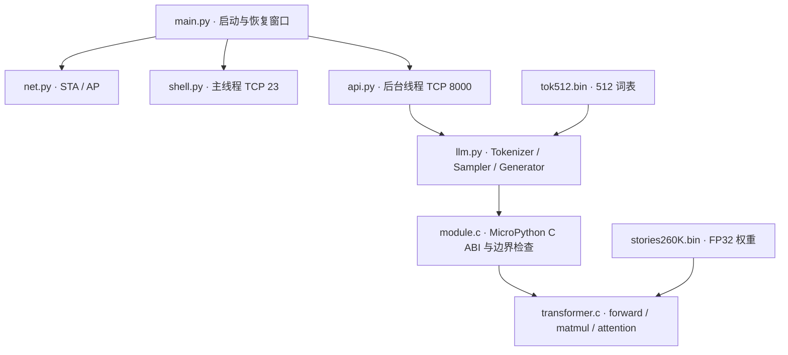
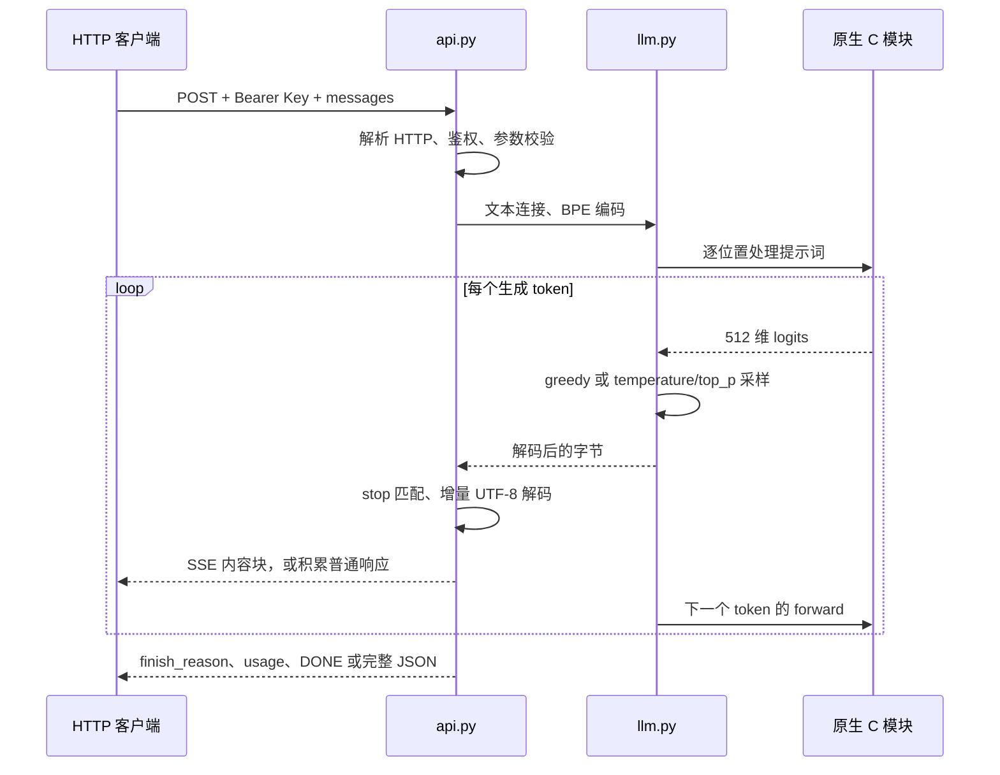

# 系统架构与实现

## 分层

Mac 的 `mpremote` 通过 USB REPL 部署文件，`esptool` 通过 ROM 下载器刷写固件。部署完成后，这两条开发链路不参与推理。HTTP 服务只使用板上文件及计算，不调用远程模型。

## 启动时序

1. `boot.py` 做垃圾回收，`main.py` 留出 2 秒 USB 恢复窗口。
2. `net.setup()` 创建 WPA2 AP，然后接入配置中的 2.4 GHz STA 网络，等待最多约 20 秒。后台持续尝试重连。
3. `llm.Model()` 读入权重与分词器，分配连续浮点运行状态。
4. 创建 32 KiB 栈的 HTTP 后台线程，监听所有网络接口的 8000 端口。
5. 主线程启动 shell，监听所有网络接口的 23 端口。

模型初始化失败时记录异常，继续尝试启动 shell，方便通过 USB 或网络修复。HTTP 线程运行中发生致命错误没有自动监督重启机制，应从日志定位或重启板子。路由器不可达时 AP 入口仍在。

## 请求执行路径

普通 JSON 与 SSE 共用同一生成器。每次请求重新从位置 0 处理提示词；没有跨请求聊天状态或 KV cache 复用。token 前向计算间短暂让出调度，使 shell 保持响应。

## 模型与内存

| 项目 | 值 |
| --- | --- |
| 训练参数 | 260,032 |
| dim / hidden_dim | 64 / 172 |
| 层数 / attention heads / KV heads | 5 / 8 / 4 |
| vocab / context | 512 / 512 |
| 权重文件 | 1,056,540 字节，含文件头和旧格式保留数据 |
| 分词器文件 | 6,227 字节 |
| C 运行状态 | 676,192 字节，含 KV cache、attention 和 logits |

大块缓冲区由 MicroPython 堆持有，使用板载 PSRAM 提供容量。C 模块不持有脱离 Python 生命周期的权重指针。不同构建会改变剩余堆空间；已测重复请求后仍有约 5.1 MB 空闲堆。

`module.c` 只接受已知权重尺寸、7 个固定配置值、4 字节对齐、正确运行状态长度和有效 token/position。切换模型需要同步修改 C 布局检查、分词器、API 元数据与参考测试。

## 并发与限制

HTTP accept 循环一次处理一个连接，backlog 为 2；生成期间 `/health` 等 HTTP 请求也会排队。多个客户端应自行串行化或设置足够超时。socket 读写超时为 5 秒，它不等于整次推理的总超时。

shell 同时最多一个会话。MicroPython GIL 和原生调用使它不等同于 Linux 多进程系统。shell 主线程使用 Timer 0 的 dupterm 通知处理中断；用户脚本应避免复用 Timer 0。

没有 TLS、SSH、OTA、进程隔离或公网入口。系统文件写保护用于防误操作，已登录 shell 用户仍能运行任意 MicroPython。

## 为什么使用原生 .mpy

借助 [MicroPython 原生模块机制](https://docs.micropython.org/en/latest/develop/natmod.html)，在保留现有 shell 和官方固件的同时，将矩阵乘法及 Transformer 前向计算放入 C。Python 负责易维护的网络协议、分词和采样。这减少了整个固件的定制构建成本，也要求明确固定 ABI 和模型布局。
