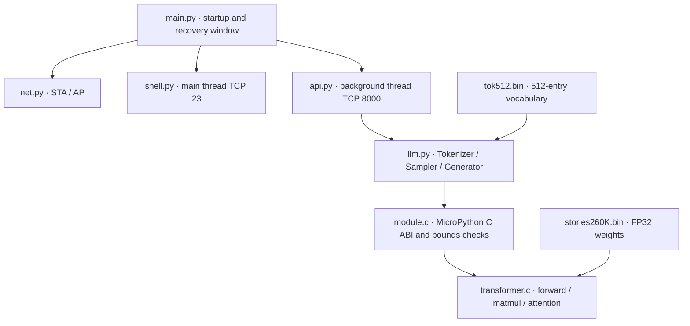
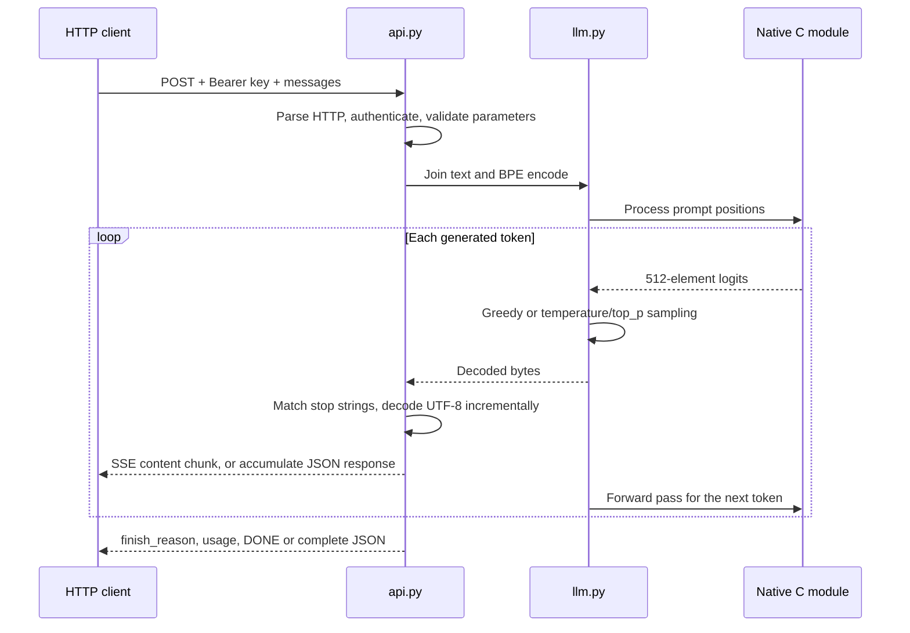

# System architecture and implementation

**English** | [简体中文](architecture.zh-CN.md)

## Layers

On the Mac, `mpremote` deploys files through the USB REPL and `esptool` flashes firmware through the ROM bootloader. Neither development connection participates in inference after deployment. The HTTP service uses only on-board files and computation; it does not call a remote model.

## Startup order

1. `boot.py` runs garbage collection; `main.py` leaves a two-second USB recovery window.
2. `net.setup()` creates a WPA2 AP, then joins the configured 2.4 GHz STA network, waiting up to about 20 seconds. Reconnection continues in the background.
3. `llm.Model()` loads weights and tokenizer and allocates contiguous floating-point state.
4. An HTTP background thread with a 32 KiB stack starts listening on port 8000 on all network interfaces.
5. The main thread starts the shell on port 23 on all network interfaces.

If model initialization fails, the exception is logged and shell startup is still attempted so the installation can be repaired over USB or the network. A fatal error inside the running HTTP thread has no automatic supervisor restart; inspect logs or reboot. The AP remains available when the router cannot be reached.

## Request execution

JSON and SSE use the same generator. Every request processes its prompt from position zero; there is no persistent conversation state or KV reuse between requests. Brief scheduling yields between token forward passes keep the shell responsive.

## Model and memory

| Property | Value |
| --- | --- |
| Trained parameters | 260,032 |
| dim / hidden_dim | 64 / 172 |
| Layers / attention heads / KV heads | 5 / 8 / 4 |
| Vocabulary / context | 512 / 512 |
| Weight file | 1,056,540 bytes, including the header and legacy reserved data |
| Tokenizer file | 6,227 bytes |
| Native state | 676,192 bytes, including KV cache, attention, and logits |

Large buffers are owned by the MicroPython heap, with capacity supplied by board PSRAM. The C module does not retain weight pointers beyond their Python owners' lifetime. Remaining heap depends on the build; approximately 5.1 MB remained after repeated requests in the recorded test.

`module.c` accepts only the known weight size, seven fixed configuration values, four-byte alignment, the expected state size, and valid tokens/positions. Changing models requires coordinated changes to C layout checks, tokenization, API metadata, and reference tests. See [model choices and constraints](models.md) for alternatives and resource formulas.

## Concurrency and limits

The HTTP accept loop handles one connection at a time, with backlog 2. Even `/health` waits behind an active generation request. Multiple clients should serialize calls or allow sufficient timeout. The socket read/write timeout is five seconds, not a total inference deadline.

The shell permits one session at a time. The MicroPython GIL and native calls do not provide Linux-style multiprocessing. Timer 0 assists dupterm interrupt notification on the main thread; user scripts should avoid reusing it.

There is no TLS, SSH, OTA, process isolation, or public Internet entry point. System-file write protection prevents accidental changes, while an authenticated shell user can still execute arbitrary MicroPython.

## Why a native .mpy module

The [MicroPython native module mechanism](https://docs.micropython.org/en/latest/develop/natmod.html) moves matrix multiplication and Transformer forward passes into C while retaining the existing shell and official firmware. Python handles networking, tokenization, and sampling. This reduces custom firmware build work but requires a pinned ABI and an explicit model layout.
