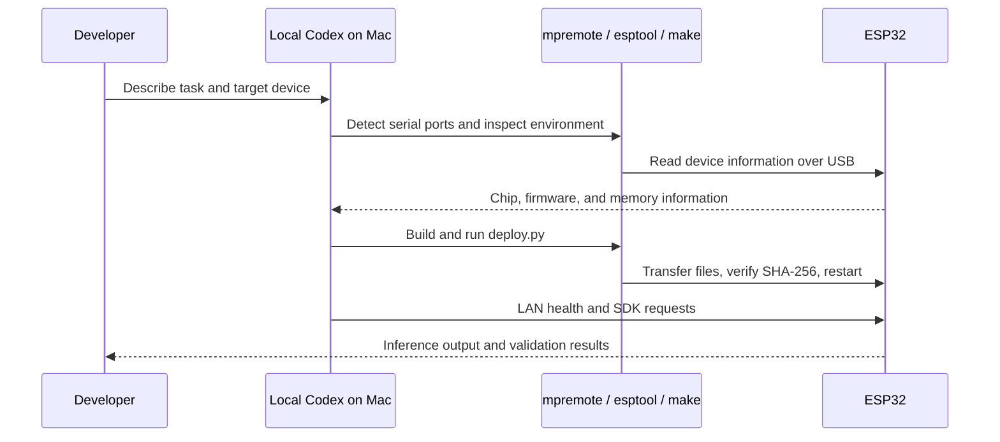

# Codex connection and development workflow

**English** | [简体中文](codex.zh-CN.md)

Codex executes development tools locally on the Mac and manages the ESP32 over USB. The board runs MicroPython, the C inference module, and HTTP service. This workflow covers installation, editing, compilation, deployment, and testing.

## Install and sign in

Follow [OpenAI Docs: Codex CLI](https://learn.chatgpt.com/docs/codex/cli):

```sh
curl -fsSL https://chatgpt.com/codex/install.sh | sh
codex --version
codex login
cd esp32-llm-service
codex -C "$PWD"
```

Use ChatGPT sign-in or another method offered by the client. Check current flags with `codex --help`. The local CLI was 0.157.1 when this project was documented; after upgrades, follow local help and official documentation.

You can also open the repository in a Codex application that supports local directories and terminal tools. Use a local session with access to the Mac's USB devices; a cloud runtime cannot directly open the Mac's `/dev/cu.*` ports.

## How Codex accesses the ESP32



Serial and network access follow the client's current permission settings. Respond to actual permission prompts when needed; this project does not require disabling all safeguards. No additional Codex service or MCP server is needed on the board. Only one maintenance tool can own a serial port at a time; close Arduino Serial Monitor, other mpremote instances, or serial terminals first.

## Suggested task prompts

Initial installation:

> Read README, AGENTS.md, and the installation guide. Inspect the local environment and ESP32 USB device; confirm chip, Flash, PSRAM, and firmware. Use existing local configuration, or generate configuration for a new device. Preserve an original firmware backup, build and deploy pinned versions, then verify JSON generation, SSE, and restart recovery. Report actual hardware results.

Service changes:

> Add a clearly scoped feature to the existing API and explain its parameter and response changes. Preserve local C inference and the shell. Run relevant host checks and, if a board is available, the corresponding hardware tests. Restore the service afterward. Do not print or commit local credentials.

Troubleshooting:

> Use the error logs to check host proxies, device IP, health, API authentication, and USB startup information in order. Identify and fix the cause. Preserve existing configuration and avoid repeated Flash erasure.

## Configuration and verification boundaries

[AGENTS.md](../AGENTS.md) contains constraints and test entry points. Codex uses tools in the project `.venv`; password files stay local. Published source excludes personal network information and device backups.

The ESP32 API key authenticates only its HTTP service. Codex uses its own login and model provider. TinyStories 260K lacks tool calling and the Responses API, so it cannot be a complete model backend for the Codex coding agent.

Reports should distinguish local host checks, real ESP32 tests, and historical measurements. A powered board remains reachable over LAN without USB. Without accessible hardware, host checks must not be described as board verification.
