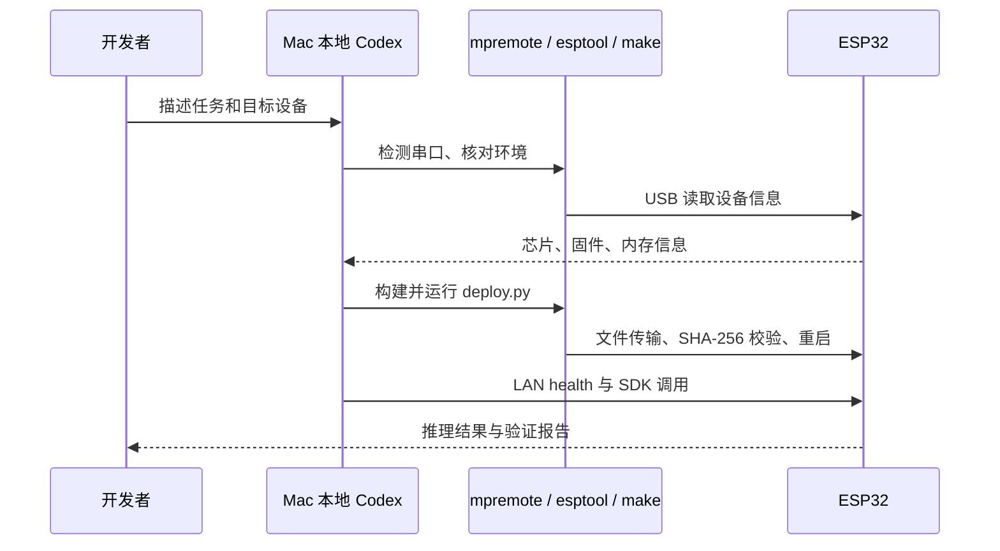

# Codex 连接与开发工作流

Codex 在 Mac 本地执行开发工具，通过 USB 管理 ESP32。ESP32 端运行 MicroPython、C 推理模块和 HTTP 服务。这个开发链路适用于安装、修改、编译、部署和测试。

## 安装与登录

参考 [OpenAI Docs：Codex CLI](https://learn.chatgpt.com/docs/codex/cli)：

```sh
curl -fsSL https://chatgpt.com/codex/install.sh | sh
codex --version
codex login
cd esp32-llm-service
codex -C "$PWD"
```

使用客户端提供的 ChatGPT 或其他可用登录方式。`codex --help` 可核对当前版本参数。本项目整理时本机 CLI 为 0.157.1；安装新版本后以本机帮助和官方文档为准。

也可在支持本机目录和终端工具的 Codex 应用中打开此仓库。需要使用能访问 Mac USB 的本地会话；云端运行环境不能直接打开 Mac 的 `/dev/cu.*`。

## 如何访问 ESP32



串口及网络访问受当前客户端权限设置控制；需要权限时按客户端实际提示处理，无需为本项目关闭所有安全限制。板子不需要额外的 Codex 服务或 MCP 服务器。USB 串口同一时刻只能由一个维护工具占用，应先关闭 Arduino Serial Monitor、其他 mpremote 或串口终端。

## 推荐任务提示词

首次安装：

> 阅读 README、AGENTS.md 和安装文档。检查本机开发环境和 ESP32 USB 设备，确认芯片、Flash、PSRAM 和固件。使用已有本地配置；若是新设备，运行配置生成器。保留原固件备份，按固定版本构建部署，然后验证普通生成、SSE 和重启恢复。报告真实硬件结果。

修改服务：

> 在现有接口上增加一个明确功能，先说明参数和响应变化。保持本地 C 推理与 shell 可用。运行相关主机检查；有板子时执行对应硬件测试，最后恢复服务。不要输出或提交本机凭据。

排查问题：

> 根据错误日志，依次核对主机代理、设备 IP、health、API 鉴权和 USB 启动信息，定位问题并修复。沿用现有配置，避免重复擦除 Flash。

## 配置与验证边界

仓库 [AGENTS.md](../AGENTS.md)包含约束和测试入口。Codex 使用仓库 `.venv` 里的工具，保持密码文件在本机。GitHub 上的源码不包含个人网络信息和设备备份。

ESP32 的 API Key 只用于调用它的 HTTP 服务。Codex 使用自己的登录身份和模型提供方。TinyStories 260K 缺少工具调用与 Responses API，不能用作 Codex 编码代理的完整模型后端。

测试报告应区分：本地主机检查、真实 ESP32 测试、历史测试记录。断开 USB 后仍可通过 LAN 调用已供电的板子；没有可访问的硬件时，不应把主机测试写成板上验证。
