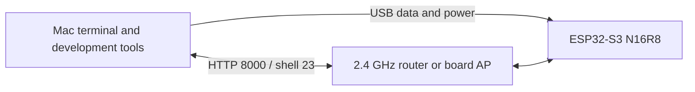

# Hardware shopping, identification, and first connection

**English** | [简体中文](hardware.zh-CN.md)

[Project README](../README.md) · [Environment setup](setup.md) · [Installation](installation.md)

The minimal setup is **one ESP32-S3 board with 16 MB Flash and 8 MB Octal PSRAM, one USB data cable, and your existing Mac**. Use an existing 2.4 GHz Wi-Fi network for LAN access; the installed board also provides a direct AP. Inference needs no display, microphone, SD card, breadboard, jumper wires, soldering, or host GPU.

The original board's ESP32-S3 rev 0.2, Flash capacity, and PSRAM configuration were verified. Its retail brand and exact PCB model were not recorded. The shopping examples below match the required specifications; they are not claims that these specific retail units were tested here.

## Shopping list

Catalog information checked on **2026-10-21**. Prices, shipping, and stock depend on the seller and checkout region. Links are manufacturer or distributor pages, without affiliate tracking.

| Item | Quantity / necessity | Specification or example model | Where to obtain it |
| --- | --- | --- | --- |
| ESP32-S3 development board | 1, required | **Waveshare ESP32-S3-DEV-KIT-N16R8**, SKU **28409**; or **N16R8-M**, SKU **28836**, with soldered headers. Both use `ESP32-S3-WROOM-1-N16R8`. Choose the onboard-antenna version. | [Waveshare international store](https://www.waveshare.com/product/mcu-tools/esp32-s3-dev-kit-n8r8.htm), explicitly select **1-N16R8**; [China store listing](https://dd.waveshare.net/shop/ESP32-S3-DEV-KIT-N16R8.htm); [manufacturer specifications/SKUs](https://docs.waveshare.net/ESP32-S3-DEV-KIT-N8R8/) |
| USB data cable | 1, required | USB 2.0 data capability; host connector must fit the Mac, board connector must fit the chosen board. The Waveshare example uses USB-C. A USB-C to USB-C cable is convenient on a USB-C Mac. | Reuse a known data cable or buy a cable explicitly sold for data/sync. A documented example is [Apple 60W USB-C Charge Cable, 1 m](https://www.apple.com/shop/product/MW493AM/A/60w-usb-c-charge-cable-1-m); Apple specifies USB 2 data transfer. The 60W rating is not required by this project. |
| Mac | 1, required for this tutorial | Existing Apple Silicon Mac with macOS, Internet access for downloads, and USB access | Use the existing computer; a new Mac or GPU is unnecessary for model inference. Other hosts are outside this tutorial's verified USB setup. |
| Wi-Fi router / AP | 1 existing network for LAN mode | 2.4 GHz, ordinary WPA2 password authentication, clients allowed to communicate | Use an existing home/office router. No specific brand is required. After installation, direct ESP32 AP access also works without a router. |
| USB power adapter | Optional, 1 for use without the Mac | Regulated 5 V USB supply; a 1 A or greater rated adapter is a practical choice for the bare board. Match its connector/cable and the board maker's power specification. | Reuse a suitable phone USB supply. During development the Mac USB connection supplies power. The project's actual peak current has not been measured. |
| USB adapter / hub | Optional, only if connectors require it | Must pass USB data and power; USB-C-to-A adapter if using an A-to-C cable with a USB-C-only Mac | Reuse an existing data adapter. A direct cable is simpler for initial troubleshooting. |

For an Espressif-branded alternative, the distributor lists [ESP32-S3-DevKitC-1-N16R8](https://www.mouser.com/en/ProductDetail/Espressif-Systems/ESP32-S3-DevKitC-1-N16R8?qs=LnCj936TGbUBJEUUxFQ%252B%252BQ%3D%3D). Check the exact module, minimum order quantity, stock, and connector before ordering. The [Espressif development-board catalog](https://www.espressif.com/en/products/devkits/esp32-s3-series/esp32-s3-devkitc-1) offers several memory variants; its default selection may differ from this tutorial.

## Select the correct variant

For a development board built around **ESP32-S3-WROOM-1**, check the complete module marking and product specification:

| Marking / listing | Meaning for this tutorial |
| --- | --- |
| `ESP32-S3-WROOM-1-N16R8` | Target: 16 MB Quad SPI Flash and 8 MB Octal PSRAM |
| `N8R8` | 8 MB Flash, 8 MB PSRAM; different Flash capacity, so do not blindly use the 16 MB backup/install recipe |
| `N16` without `R8` | 16 MB Flash but no PSRAM in this module variant; does not match this project |
| `N16R2` | 2 MB Quad PSRAM; does not match the 8 MB Octal setup |
| `WROOM-1U` / external-antenna listing | Needs the matching external antenna; choose onboard antenna for a simpler starter setup |
| `WROOM-2`, `N16R8V`, or `N32R16V` | Different Flash/memory configuration; check its own datasheet and firmware rather than assuming this pinned image is compatible |
| ESP32, ESP32-C3, ESP32-C6, or ESP32-S2 | Different chip target; not a substitute for ESP32-S3 in this build |

These suffix details come from the [Espressif WROOM-1/WROOM-1U datasheet](https://www.espressif.com/sites/default/files/documentation/esp32-s3-wroom-1_wroom-1u_datasheet_en.pdf). **Octal PSRAM does not imply Octal Flash**: the target WROOM-1-N16R8 combines Quad Flash with Octal PSRAM. Buy a complete development board with USB and BOOT/RESET buttons; the bare shielded module alone needs a carrier and power circuitry.

On a marketplace, search for `ESP32-S3 N16R8 16MB Flash 8MB PSRAM native USB development board`, then confirm the selected variant and module photo with the seller. In Chinese shops, use `ESP32-S3 N16R8 开发板 16MB Flash 8MB PSRAM 原生USB`. The product title can describe a whole family while the selected SKU defaults to a smaller version. Headers are unused by this project, so either header option is sufficient.

## First connection



1. Put the board on a nonconductive surface. Confirm the module marking, USB connector, BOOT button, and RESET/EN button using the manufacturer's diagram.
2. Plug a data cable into the Mac and the board's **native ESP32 USB connection**. On boards with two sockets, consult the labels/diagram to distinguish native USB from USB-UART.
3. The Waveshare example exposes native ESP32 USB and a CH343 serial bridge through one USB-C socket and an onboard hub. Seeing two ports is expected; select the native Espressif port for this firmware's USB REPL. See the [manufacturer port guide](https://docs.waveshare.net/ESP32-S3-DEV-KIT-N8R8/FAQ/).
4. Complete the README's Python environment step, then list ports:

```sh
.venv/bin/python -m serial.tools.list_ports -v
```

5. Unplug and reconnect to identify which device appears. A native Espressif device normally reports VID `303A` and a macOS `/dev/cu.usbmodem...` path. Use the actual detected path; the digits are unique to the connection/device.
6. If the factory firmware does not expose native USB, hold BOOT, tap RESET, release BOOT, and list ports again. If nothing appears, try another known data cable and Mac port. A power LED alone does not prove USB data is working.
7. Continue with the [installation guide](installation.md): identify Flash, back up, install MicroPython, configure, and deploy. After flashing, detect the port again before `mpremote` operations.

The native USB path does not require a CH343/CP210x driver. A separate USB-UART bridge may need its manufacturer's driver, but installing bridge drivers does not fix a charge-only cable or the wrong socket. Use the board manufacturer's instructions for that interface.

## Installation checkpoints

Run each stage from the repository root. Stop at a failed checkpoint and use the linked guide before moving on.

| Stage | Expected evidence | Next place to look if it fails |
| --- | --- | --- |
| Python and toolchain installed | `.venv/bin/python -m pip check` succeeds; `arduino-cli core list` includes `esp32:esp32 3.3.8` | [Environment setup](setup.md) |
| Assets prepared and native module built | Download hashes pass; `native/tinyllm_native.mpy` exists | [Build guide](../BUILD.md) |
| Board identified | `esptool flash-id` reports ESP32-S3 and 16 MB Flash | [Identify the board](installation.md#1-identify-the-target-board) |
| Backup saved | `backups/original.bin` is 16,777,216 bytes; the SHA-256 file is present | [Backup](installation.md#2-back-up-the-original-firmware) |
| MicroPython installed | Version 1.29.0 and several MB of free heap before application loading | [Firmware installation](installation.md#3-install-firmware) |
| Settings generated | Both private configuration files exist; passwords were entered/generated locally | [Configuration](installation.md#4-configure-the-device-and-prepare-the-model) |
| Files deployed | File hashes pass and the board restarts | [Deployment](installation.md#5-deploy) |
| Network reachable | `/health` returns JSON after startup; `/v1/models` succeeds with the local key | [API examples](api.md) |
| Inference and shell work | An English story continuation appears; shell login and `ifconfig` work | [Operations](operations.md) |
| Independent power | After moving to a USB power adapter, the board rejoins Wi-Fi and health responds at its current IP | [Restart and network troubleshooting](operations.md) |

A failed LAN test can be isolated by joining the board AP and calling `http://192.168.4.1:8000/health`. A successful HTTP reply verifies reachability; use an authenticated generation request to verify inference. The board AP does not provide Internet access to the Mac.
