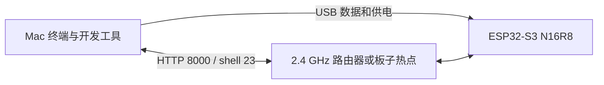

# 硬件采购、型号识别与首次连接

[English](hardware.md) | **简体中文**

[项目 README](../README.zh-CN.md) · [环境准备](setup.zh-CN.md) · [安装步骤](installation.zh-CN.md)

最小配置是 **1 块 16 MB Flash / 8 MB Octal PSRAM 的 ESP32-S3 开发板、1 根 USB 数据线，以及现有 Mac**。局域网调用使用已有的 2.4 GHz Wi-Fi；安装后也能直连板子热点。推理无需屏幕、麦克风、SD 卡、面包板、杜邦线、焊接或主机 GPU。

原设备已验证 ESP32-S3 rev 0.2、Flash 容量和 PSRAM 配置，但未记录零售品牌及准确 PCB 型号。下方采购示例符合所需规格，不代表这些具体零售板已经在本项目中逐一实测。

## 采购清单

产品目录核对日期：**2026-10-21**。价格、运费和库存以购买地区及结算页为准。链接为厂商或分销商页面，不含推广追踪参数。

| 物品 | 数量 / 是否必需 | 规格或参考型号 | 获取 / 购买方式 |
| --- | --- | --- | --- |
| ESP32-S3 开发板 | 1 块，必需 | **微雪 ESP32-S3-DEV-KIT-N16R8**，SKU **28409**；或已焊排针的 **N16R8-M**，SKU **28836**。均搭载 `ESP32-S3-WROOM-1-N16R8`，选择板载天线版。 | [微雪国际商城](https://www.waveshare.com/product/mcu-tools/esp32-s3-dev-kit-n8r8.htm)，明确选择 **1-N16R8**；[中文商城型号页](https://dd.waveshare.net/shop/ESP32-S3-DEV-KIT-N16R8.htm)；[厂商规格及 SKU](https://docs.waveshare.net/ESP32-S3-DEV-KIT-N8R8/) |
| USB 数据线 | 1 根，必需 | 支持 USB 2.0 数据；两端分别匹配 Mac 和开发板。上述微雪板为 USB-C，USB-C Mac 可用 C-to-C 线。 | 优先使用已知能传数据的现有线，购买时选“数据/同步”线。可参考 [Apple 60W USB-C 充电线 1 米](https://www.apple.com/shop/product/MW493AM/A/60w-usb-c-charge-cable-1-m)，官方注明支持 USB 2 数据传输；本项目并不要求 60W 规格。 |
| Mac | 1 台，本教程必需 | 现有 Apple Silicon Mac、macOS、可下载依赖的网络及 USB 接口 | 使用现有电脑即可，无需为模型推理购买新 Mac 或 GPU；其他主机不在本教程已验证 USB 环境范围内。 |
| Wi-Fi 路由器 / 热点 | LAN 模式需要 1 个现有网络 | 2.4 GHz、普通 WPA2 密码认证、允许客户端互访 | 使用家用或办公路由器，无固定品牌要求；安装后使用 ESP32 自建热点也可不依赖路由器。 |
| USB 电源适配器 | 可选，脱离 Mac 运行时 1 个 | 稳定 5 V USB 供电；裸板可选择额定 1 A 或更高的适配器，接口和线材匹配，并遵循板厂供电要求 | 优先复用合适的手机 USB 电源；开发期间 Mac USB 即可供电。本项目未测量实际峰值电流。 |
| USB 转接头 / Hub | 可选，接口不匹配时使用 | 同时支持数据和供电；例如 USB-C Mac 搭配 A-to-C 线时使用 C-to-A 转接头 | 优先复用已有数据转接头；首次排障时直接接线更简单。 |

如需乐鑫品牌，可参考分销商的 [ESP32-S3-DevKitC-1-N16R8](https://www.mouser.com/en/ProductDetail/Espressif-Systems/ESP32-S3-DevKitC-1-N16R8?qs=LnCj936TGbUBJEUUxFQ%252B%252BQ%3D%3D)。下单前核对模组、最小起订量、库存和接口。[乐鑫开发板目录](https://www.espressif.com/en/products/devkits/esp32-s3-series/esp32-s3-devkitc-1)有多种存储配置，默认选项可能与本教程不同。

## 如何选对版本

对于搭载 **ESP32-S3-WROOM-1** 的开发板，要核对完整模组丝印和商品规格：

| 丝印 / 商品选项 | 对本教程的含义 |
| --- | --- |
| `ESP32-S3-WROOM-1-N16R8` | 目标配置：16 MB Quad SPI Flash、8 MB Octal PSRAM |
| `N8R8` | 8 MB Flash、8 MB PSRAM；Flash 容量不同，不能照搬 16 MB 备份和安装流程 |
| `N16`，没有 `R8` | 此模组版本有 16 MB Flash，但没有 PSRAM，不符合本项目配置 |
| `N16R2` | 2 MB Quad PSRAM，不符合 8 MB Octal 配置 |
| `WROOM-1U` / 外置天线版 | 需搭配适当的外置天线；新手选板载天线更方便 |
| `WROOM-2`、`N16R8V`、`N32R16V` | Flash/内存配置不同，需查各自规格及固件，不能默认兼容本文固定固件 |
| ESP32、ESP32-C3、ESP32-C6、ESP32-S2 | 芯片目标不同，不能替代本构建要求的 ESP32-S3 |

后缀信息依据[乐鑫 WROOM-1/WROOM-1U 数据手册](https://www.espressif.com/sites/default/files/documentation/esp32-s3-wroom-1_wroom-1u_datasheet_en.pdf)。**Octal PSRAM 不代表 Flash 也是 Octal**：目标 WROOM-1-N16R8 是 Quad Flash 加 Octal PSRAM。应购买带 USB、BOOT 和 RESET 按钮的完整开发板；只有金属屏蔽罩的裸模组还需要底板和供电电路。

在淘宝、京东等平台可搜索 `ESP32-S3 N16R8 开发板 16MB Flash 8MB PSRAM 原生USB`，再向商家核对已选规格和模组实物照片；英文搜索词为 `ESP32-S3 N16R8 16MB Flash 8MB PSRAM native USB development board`。商品标题可能描述整个系列，而默认选中的是小容量版本。本项目不用排针，两种排针选项都可。

## 第一次插线



1. 将板子放在绝缘表面，按厂商示意图找到模组丝印、USB 接口、BOOT 按钮和 RESET/EN 按钮。
2. 用数据线连接 Mac 与板子的 **ESP32 原生 USB 接口**。双接口板按丝印及示意图区分原生 USB 与 USB-UART。
3. 上述微雪板通过一个 USB-C 接口及板载 Hub 同时连接原生 USB 和 CH343 串口桥，因此出现两个端口是正常的。本固件 USB REPL 选择原生 Espressif 端口，参见[厂商端口识别说明](https://docs.waveshare.net/ESP32-S3-DEV-KIT-N8R8/FAQ/)。
4. 先完成 README 的 Python 环境步骤，再列出端口：

```sh
.venv/bin/python -m serial.tools.list_ports -v
```

5. 拔插一次，比较新增设备。原生 Espressif 设备通常显示 VID `303A`，Mac 路径形如 `/dev/cu.usbmodem...`。使用实际查到的路径，不要照抄其他设备的数字后缀。
6. 若出厂固件不提供原生 USB，按住 BOOT、点按 RESET、松开 BOOT，再列端口。仍无设备时更换已知能传数据的线及 Mac 接口；电源灯亮不能证明数据线正常。
7. 继续[安装文档](installation.zh-CN.md)，核对 Flash、备份、安装 MicroPython、配置并部署。刷写后重新识别端口，再运行 `mpremote`。

原生 USB 不需要 CH343/CP210x 驱动；独立 USB-UART 桥可能需要其厂商驱动，但装桥接驱动无法修复纯充电线或插错接口的问题。该接口以板厂说明为准。

## 每一步的成功标志

所有命令均在仓库根目录执行。某个检查点失败时，先按对应文档处理，再继续后续步骤。

| 阶段 | 应看到的证据 | 失败时查看 |
| --- | --- | --- |
| Python 与工具链安装 | `.venv/bin/python -m pip check` 成功；`arduino-cli core list` 包含 `esp32:esp32 3.3.8` | [环境准备](setup.zh-CN.md) |
| 下载与原生模块构建 | 下载校验通过，存在 `native/tinyllm_native.mpy` | [构建文档](../BUILD.zh-CN.md) |
| 识别板子 | `esptool flash-id` 显示 ESP32-S3 和 16 MB Flash | [找到目标板](installation.zh-CN.md#1-找到目标板) |
| 保存备份 | `backups/original.bin` 为 16,777,216 字节，另有 SHA-256 文件 | [备份](installation.zh-CN.md#2-备份原固件) |
| 安装 MicroPython | 版本为 1.29.0，加载应用前有数 MB 空闲堆 | [安装固件](installation.zh-CN.md#3-安装固件) |
| 生成配置 | 两个私有配置文件均存在，密码在本机输入或生成 | [配置](installation.zh-CN.md#4-配置与模型) |
| 部署文件 | 文件校验成功，板子重启 | [部署](installation.zh-CN.md#5-部署) |
| 网络可达 | 启动后 `/health` 返回 JSON；带本地 Key 的 `/v1/models` 成功 | [API 示例](api.zh-CN.md) |
| 推理与 shell 正常 | 能生成英文续写，能登录 shell 并执行 `ifconfig` | [运维文档](operations.zh-CN.md) |
| 独立供电 | 改用 USB 电源后重新接入 Wi-Fi，并可通过当前 IP 访问 health | [重启与网络排障](operations.zh-CN.md) |

LAN 不通时，连接板子热点访问 `http://192.168.4.1:8000/health` 可隔离网络问题。HTTP 返回成功证明连接可达；还需带鉴权的生成请求验证推理。板子热点不会为 Mac 转发互联网。
